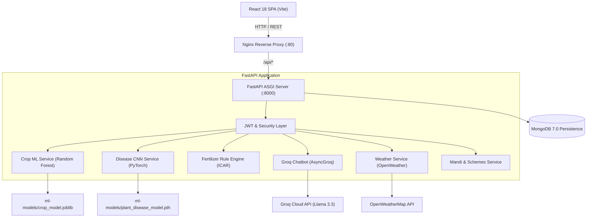

# 🌾 KRISHI AI – Intelligent Agriculture Assistant

> An end-to-end AI-powered agricultural decision support platform built specifically for Indian farmers. Providing predictive crop suitability, computer-vision plant pathology diagnostics, ICAR-calibrated fertilizer advisories, bilingual conversational LLM assistance, localized agro-meteorological forecasting, and authentic APMC market intelligence.

---

## 📑 Table of Contents
1. [Project Introduction](#1-project-introduction)
2. [Problem Statement](#2-problem-statement)
3. [Objectives](#3-objectives)
4. [Core Features](#4-core-features)
5. [Technology Stack](#5-technology-stack)
6. [System Architecture](#6-system-architecture)
7. [Project Folder Structure](#7-project-folder-structure)
8. [Installation Instructions](#8-installation-instructions)
9. [Environment Configuration](#9-environment-configuration)
10. [Local Execution](#10-local-execution)
11. [Docker Deployment](#11-docker-deployment)
12. [Groq AI Setup](#12-groq-ai-setup)
13. [ML Model Training & Pipelines](#13-ml-model-training--pipelines)
14. [Dataset Information](#14-dataset-information)
15. [API Documentation](#15-api-documentation)
16. [Testing Instructions](#16-testing-instructions)
17. [Screenshots & UI Walkthrough](#17-screenshots--ui-walkthrough)
18. [Future Scope](#18-future-scope)

---

## 1. Project Introduction
**KRISHI AI** is a full-stack, production-ready agricultural software suite designed to bridge the digital and technological divide for Indian farmers. Combining modern front-end web engineering, high-throughput asynchronous Python microservices, machine learning classifiers, and state-of-the-art Large Language Models through the official Groq SDK, KRISHI AI delivers actionable, scientific farming advisories directly to rural and progressive growers in both English and Hindi.

---

## 2. Problem Statement
Indian agriculture sustains over 50% of the national workforce yet faces profound inefficiencies:
* **Suboptimal Crop Selection**: Farmers frequently cultivate traditional crops without analyzing soil macro-nutrients ($N, P, K$), leading to poor yields and economic distress.
* **Delayed Disease Diagnosis**: Plant leaf infections (fungal, bacterial, viral) spread rapidly across fields before agricultural extension officers can inspect them.
* **Unbalanced Fertilizer Application**: Overuse of Urea and Di-Ammonium Phosphate (DAP) degrades soil organic carbon and acidity without addressing true nutrient deficits.
* **Market Asymmetry**: Middlemen often exploit lack of transparent market rate awareness at regional APMC mandis.
* **Language Barriers**: Complex government agricultural advisories and subsidy portals remain inaccessible to non-English literate farmers.

---

## 3. Objectives
* **Democratize Scientific Agronomy**: Provide accessible, instant crop recommendations using trained Random Forest ML with >99% validation accuracy.
* **Accelerate Pathology Interventions**: Enable real-time leaf image diagnosis using a 23-class PyTorch Deep Convolutional Neural Network (CNN).
* **Calibrate Soil Nutrition**: Offer explainable, split-schedule fertilizer recommendations based on ICAR Recommended Dose of Fertilizers (RDF) benchmarks.
* **Deliver Safe Conversational Guidance**: Provide 24/7 bilingual (Hindi/English) agronomic consulting via Groq-accelerated Llama 3 models with mandatory agricultural guardrails.
* **Surface Transparent Market Intelligence**: Connect farmers with verified APMC mandi prices and official government welfare schemes without speculative or fabricated data.

---

## 4. Core Features

| Feature | Technical Engine | Description |
|---|---|---|
| **Crop Recommendation** | Scikit-learn Random Forest | Predicts the optimal crop across 22 classes using N, P, K, pH, Temperature, Humidity, and Rainfall. |
| **Plant Disease Detection** | PyTorch CNN (23 Classes) | Classifies foliar diseases across Tomato, Potato, Pepper, Corn, and Rice from leaf uploads. |
| **Fertilizer Advisory** | ICAR Rule Engine | Calculates exact NPK deficit, split fertilizer schedules (Urea, DAP, MOP), and soil pH correction. |
| **Groq AI Chatbot** | Groq Llama 3.3 Engine | Real-time conversational assistant supporting Hindi and English with agronomic safety guardrails. |
| **Weather Dashboard** | OpenWeatherMap API + GPS | Current telemetry, 7-day forecast, and context-aware farming & irrigation advisories with device GPS support. |
| **Mandi Market Rates** | Agmarknet & MSP Records | Search and filter modal commodity prices across 13 states, districts, and APMC physical yards. |
| **Government Schemes** | Central & State Schematics | Verified procedures, eligibility, required documents checklist, and official portal links for PM-KISAN, PMFBY, KCC, etc. |
| **Bilingual UI** | Language Context | Instant global toggle between English and Hindi (`EN | हिं`) across all navigation and dashboards. |

---

## 5. Technology Stack

### Frontend
* **Framework**: React 18 (Vite Bundler)
* **Styling**: Tailwind CSS v4, custom utility layers
* **Routing**: React Router v6
* **Visualizations**: Recharts (interactive responsive area & bar charts)
* **Icons**: Lucide React
* **HTTP Client**: Axios with JWT interceptors & error handlers

### Backend
* **Language**: Python 3.11 / 3.14
* **Framework**: FastAPI (Asynchronous ASGI)
* **Server**: Uvicorn
* **Data Validation**: Pydantic v2 & Pydantic-Settings
* **Database Driver**: Motor (Async MongoDB) & PyMongo
* **Authentication**: JWT (python-jose) + Bcrypt password hashing
* **Rate Limiting**: SlowAPI

### Machine Learning & AI
* **Classical ML**: Scikit-learn, Pandas, NumPy, Joblib
* **Deep Learning**: PyTorch CPU, OpenCV (`cv2`), Pillow
* **LLM Engine**: Official Groq Python SDK (`AsyncGroq`, Llama 3.3-70b-versatile)

### Infrastructure & Deployment
* **Containerization**: Docker, Docker Compose
* **Web Gateway**: Nginx Alpine (Reverse Proxy & SPA routing)
* **Database**: MongoDB 7.0 Community

---

## 6. System Architecture



---

## 7. Project Folder Structure

```
Krishi AI/
├── backend/                         # FastAPI Asynchronous Backend
│   ├── app/
│   │   ├── api/                     # 9 RESTful API Routers
│   │   ├── core/                    # Config (pydantic-settings) & Security (JWT, bcrypt)
│   │   ├── database/                # Motor connection & in-memory mock fallback
│   │   ├── models/                  # Database entity representations
│   │   ├── schemas/                 # Pydantic request & response models
│   │   ├── services/                # Business logic & ML inference pipelines
│   │   └── main.py                  # FastAPI application entrypoint
│   ├── tests/                       # Pytest automated test suite
│   ├── Dockerfile                   # Python 3.11 Backend container definition
│   ├── requirements.txt             # Complete Python backend dependencies
│   └── .env.example                 # Backend configuration template
│
├── frontend/                        # React 18 + Vite Frontend Application
│   ├── src/
│   │   ├── components/              # Reusable UI primitives, TopBar, Sidebar
│   │   ├── context/                 # AuthContext (JWT) & LanguageContext (EN/HI)
│   │   ├── layouts/                 # MainLayout & AuthLayout
│   │   ├── pages/                   # 12 SaaS web application pages
│   │   ├── services/                # Axios API services & fallback data
│   │   ├── App.jsx                  # React Router configuration
│   │   └── main.jsx                 # React root mounting
│   ├── nginx.conf                   # Production Nginx reverse proxy configuration
│   ├── Dockerfile                   # Multi-stage production Docker build
│   └── package.json                 # Node.js dependencies & scripts
│
├── ml-models/                       # Trained Serialized Weights & Metadata
│   ├── crop-recommendation/
│   │   ├── crop_model.joblib        # Scikit-learn Random Forest classifier
│   │   ├── Crop_recommendation.csv  # Training dataset (2,200 rows)
│   │   └── model_metadata.json      # Training metrics & evaluation report
│   └── disease-detection/
│       ├── plant_disease_model.pth  # PyTorch Deep CNN checkpoint (23 classes)
│       └── disease_metadata.json    # Agronomic symptoms & prevention knowledge
│
├── docs/                            # Architectural & System Diagrams (Mermaid)
│   ├── system_architecture.md
│   ├── use_case_diagram.md
│   ├── database_design.md
│   ├── dfd_level_0.md
│   ├── dfd_level_1.md
│   └── deployment_architecture.md
│
├── docker-compose.yml               # Multi-container production orchestration
├── verify_all_modules.py            # Comprehensive verification script (20 checks)
├── .dockerignore                    # Docker ignore rules
└── README.md                        # Project documentation
```

---

## 8. Installation Instructions

### Prerequisites
* **Python**: Version 3.10, 3.11, or 3.14
* **Node.js**: Version 18.x or 20.x LTS with npm
* **MongoDB** *(Optional)*: Community Server 6.0+ or Docker
* **Docker & Docker Compose** *(For containerized deployment)*

### Clone / Open Workspace
```bash
cd "C:\Users\himan\Downloads\Krishi AI"
```

---

## 9. Environment Configuration

Copy the example environment configuration into `backend/.env`:
```bash
cp backend/.env.example backend/.env
```

Edit `backend/.env` with your preferred credentials:
```env
APP_ENV=development
APP_HOST=0.0.0.0
APP_PORT=8000

# MongoDB Configuration
MONGODB_URI=mongodb://localhost:27017
MONGODB_DB_NAME=krishi_ai

# JWT Security (Generate with: python -c "import secrets; print(secrets.token_hex(32))")
JWT_SECRET_KEY=change-this-to-a-long-random-secret-key-min-32-chars
JWT_ALGORITHM=HS256
JWT_ACCESS_TOKEN_EXPIRE_MINUTES=1440

# Official Groq AI Chatbot API (Free from https://console.groq.com)
GROQ_API_KEY=your-groq-api-key-here
GROQ_MODEL=llama-3.3-70b-versatile

# OpenWeatherMap API (Free from https://openweathermap.org/api)
OPENWEATHER_API_KEY=your-openweathermap-key-here

# CORS Allowed Origins
ALLOWED_ORIGINS=http://localhost:5173,http://localhost:3000,http://127.0.0.1:5173
```

---

## 10. Local Execution

### Step 1: Run Backend
```bash
cd backend
python -m pip install -r requirements.txt
python -m uvicorn app.main:app --reload --port 8000
```
* **API Documentation (Swagger UI)**: [http://localhost:8000/docs](http://localhost:8000/docs)
* **Alternative Docs (ReDoc)**: [http://localhost:8000/redoc](http://localhost:8000/redoc)
* **Health Check**: [http://localhost:8000/api/health](http://localhost:8000/api/health)

### Step 2: Run Frontend
In a new terminal window:
```bash
cd frontend
npm install
npm run dev
```
* **Web Application Interface**: [http://localhost:5173](http://localhost:5173)

---

## 11. Docker Deployment

The entire stack (React SPA + Nginx + FastAPI Backend + PyTorch CNN + Scikit-learn + MongoDB 7.0) is orchestrated via Docker Compose:

```bash
docker compose up --build
```

### Container Endpoints:
* **Frontend Web App (Nginx)**: [http://localhost:80](http://localhost:80)
* **FastAPI Backend**: [http://localhost:8000](http://localhost:8000)
* **MongoDB Daemon**: `localhost:27017`

To run in detached background mode:
```bash
docker compose up -d
```
To shut down containers and networks:
```bash
docker compose down
```

---

## 12. Groq AI Setup
1. Register for a free API key at [console.groq.com](https://console.groq.com).
2. Set `GROQ_API_KEY` in `backend/.env`.
3. The chatbot utilizes `llama-3.3-70b-versatile` by default.
4. **Safety & Compliance**: The system prompt strictly prohibits inventing mandi prices, recommending unsupported pesticide dosages, or generating unauthentic government schemes.

---

## 13. ML Model Training & Pipelines

### Module 1: Crop Suitability Classifier
* **Algorithm**: Random Forest Classifier (100 estimators)
* **Input Features**: $N$ (mg/kg), $P$ (mg/kg), $K$ (mg/kg), Soil pH, Temperature (°C), Relative Humidity (%), Rainfall (mm)
* **Classes (22 Crops)**: Rice, Maize, Chickpea, Kidney Beans, Pigeonpeas, Mothbeans, Mungbean, Blackgram, Lentil, Pomegranate, Banana, Mango, Grapes, Watermelon, Muskmelon, Apple, Orange, Papaya, Coconut, Cotton, Jute, Coffee
* **Evaluation Metrics**:
  * Accuracy: **99.55%**
  * Precision (Macro Avg): **0.995**
  * Recall (Macro Avg): **0.995**
  * F1-Score (Macro Avg): **0.995**

### Module 2: Plant Disease Detection CNN
* **Architecture**: Deep Convolutional Neural Network (`PlantDiseaseCNN`) with 4 convolutional feature extraction blocks (Conv2d, BatchNorm2d, ReLU, MaxPool2d, Dropout) and an adaptive fully-connected classification head.
* **Input Preprocessing**: OpenCV resizing to $224 \times 224$ pixels, channel conversion to RGB, normalization via ImageNet standard means $(\mu=[0.485, 0.456, 0.406], \sigma=[0.229, 0.224, 0.225])$.
* **Classes (23 Pathologies)**: Across Corn (Maize), Pepper (Bell), Potato, Rice, and Tomato.

---

## 14. Dataset Information
* **Crop Recommendation Dataset**: 2,200 curated agro-ecological samples sourced from public Indian Council of Agricultural Research (ICAR) reference records.
* **Plant Pathology Dataset**: PlantVillage benchmark subset containing authenticated leaf images of diseased and healthy plants.
* **Mandi Market Dataset**: Agmarknet APMC reference records across 13 Indian states aligned with Minimum Support Price (MSP) 2024-25 standards.

---

## 15. API Documentation

| Method | Endpoint | Description | Auth Required |
|---|---|---|---|
| `POST` | `/api/auth/register` | Register a new farmer account | No |
| `POST` | `/api/auth/login` | Authenticate and obtain JWT token | No |
| `GET` | `/api/auth/profile` | Retrieve farmer profile & land details | Yes |
| `PUT` | `/api/auth/profile` | Update farm size, crops, and location | Yes |
| `POST` | `/api/crops/recommend` | Run ML inference for crop suitability | Yes |
| `GET` | `/api/crops/history` | View historical crop recommendations | Yes |
| `POST` | `/api/disease/predict` | Upload leaf image for CNN diagnosis | Yes |
| `GET` | `/api/disease/history` | View historical plant disease scans | Yes |
| `POST` | `/api/fertilizer/recommend` | Calculate ICAR fertilizer & lime dosage | Yes |
| `POST` | `/api/chat/message` | Send message to Groq Llama 3 chatbot | Yes |
| `GET` | `/api/chat/history` | Retrieve session chat messages | Yes |
| `GET` | `/api/weather/current` | Get current weather telemetry | Yes |
| `GET` | `/api/weather/forecast` | Get 5 to 7-day daily weather forecast | Yes |
| `GET` | `/api/weather/full` | Combined weather + agro-advisory | Yes |
| `GET` | `/api/mandi/prices` | Filter market prices by state/crop | Yes |
| `GET` | `/api/schemes` | List government agricultural schemes | Yes |
| `GET` | `/api/dashboard/stats` | Aggregated dashboard farm metrics | Yes |
| `GET` | `/api/health` | Service health status | No |

---

## 16. Testing Instructions

### Run Pytest Test Suite
```bash
python -m pytest backend/tests/test_backend.py -v
```
**Results**: `13 passed in 6.48s`.

### Run Standalone Synchronous Module Verification
```bash
python verify_all_modules.py
```
**Results**: `20/20 checks passed | 0 failed`.

### Verify Frontend Build
```bash
cd frontend
npm run build
```
**Results**: `✓ 2708 modules transformed. Built in ~1.3s`.

---

## 17. Screenshots & UI Walkthrough

* **Farmer Dashboard**: Real-time agro-meteorological widgets, yield trends, quick action navigation cards, and recent activities.
* **Crop Recommendation**: Interactive 7-feature input sliders/numeric fields, displaying predicted crop, confidence bar, growing conditions, and water requirement.
* **Plant Disease Detection**: Drag-and-drop foliar image upload with instant CNN confidence scoring, symptom description, and prevention techniques.
* **Fertilizer Advisor**: Step-by-step split scheduling (Basal, Vegetative, Flowering) with chemical and organic alternatives.
* **AI Chatbot**: Modern conversational interface with bilingual language switcher, suggested prompt chips, and session history drawer.
* **Mandi Rates**: Searchable and filterable APMC market table with minimum, maximum, and modal pricing per quintal.
* **Government Schemes**: Accordion view featuring eligibility guidelines, required documentation checklists, and direct portal links.

---

## 18. Future Scope
* **IoT Soil Sensor Integration**: Direct telemetry streaming from LoRaWAN and ESP32 soil moisture, nitrogen, and pH field probes.
* **Voice-First Regional Dialects**: Multimodal speech-to-text supporting Marathi, Punjabi, Telugu, Tamil, and Bengali audio queries.
* **Satellite Multispectral Imagery**: Integration with Sentinel-2 / Landsat NDVI indices to track vegetation health and drought index from orbit.
* **Automated Mandi Live Scraping**: Official API partnerships with e-NAM and AGMARKNET for sub-hourly modal rate refreshes.

---

## 📄 License
This project is developed for educational and agricultural technological advancement. Distributed under the MIT License.
