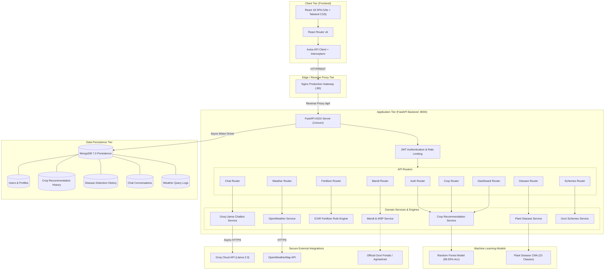

# KRISHI AI – System Architecture

## Overview
KRISHI AI employs a modular, decoupled 3-tier architecture composed of a React 18 client single-page application (SPA), an asynchronous FastAPI (Python) backend engine serving specialized Machine Learning pipelines and rule engines, and MongoDB for structured persistence.

